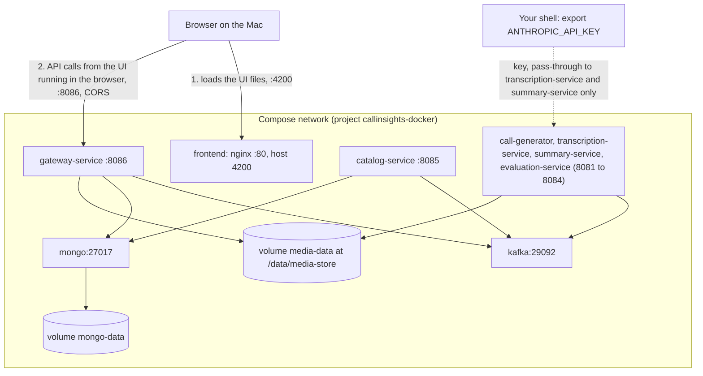

# Running CallInsights with Docker

This guide covers the Docker path: the whole system (infra, the six services and the frontend) built and started from the root `docker-compose.yml` with one command. For the services-from-source path, see [README.md](README.md) in this folder.

## Two ways to run

| | Scripts | Docker |
| --- | --- | --- |
| Start | `scripts/start-all.sh` | `scripts/docker-up.sh` (or `docker compose up -d --build`) from the repo root |
| Stop | `scripts/stop-all.sh` | `docker compose down` from the repo root |
| Services | Host jars built from source, logs in `logs/` | Containers built from the root `Dockerfile` |
| Infra | Infra-only Compose project `infra`, started from `infra/` | Included in Compose project `callinsights-docker` |
| Frontend | `ng serve` on port 4200 | nginx container, host port 4200 |
| Media and artifacts | `$HOME/call-insights-pipeline/media-store` | Named volume `media-data` |
| Use it for | Day-to-day development and debugging in an IDE | A clean, one-command run from a fresh clone |

**The two cannot run at the same time.** Both use the fixed container names from `infra/docker-compose.yml` (`call-insights-kafka`, `call-insights-mongo`, ...) and the same host ports (8081 to 8086, 4200, 9092, 27017, 8090, 8091). Run `scripts/stop-all.sh` before the Docker path, and `docker compose down` before the script path.

Requirements: Docker with Compose v2.20 or later (the root file uses `include`). Six JVMs plus Kafka and MongoDB need about 6 GB of memory in Docker Desktop.

## Start, check, stop

```bash
export ANTHROPIC_API_KEY="..."     # per terminal session; never commit it
scripts/docker-up.sh               # or: docker compose up -d --build
docker compose ps                  # every service should show (healthy)
docker compose logs -f gateway-service
docker compose down                # stop; data is kept in the volumes
```

UI: `http://localhost:4200`. Gateway: `http://localhost:8086` (curl examples in [API_TESTING.md](API_TESTING.md)). Kafka UI: `http://localhost:8090`. Mongo Express: `http://localhost:8091`.

## Network and service names

All containers share the Compose network of project `callinsights-docker` and reach each other by service name. The services keep their `application.yml` defaults (which point at `localhost`) and get the container addresses through environment variables (Spring relaxed binding; no extra profile files):

| Setting | Variable | Value | Services |
| --- | --- | --- | --- |
| Kafka | `SPRING_KAFKA_BOOTSTRAP_SERVERS` | `kafka:29092` (the internal `PLAINTEXT` listener) | all six |
| MongoDB | `SPRING_DATA_MONGODB_URI` | `mongodb://mongo:27017/call-insights` | catalog-service, gateway-service |
| Media and artifacts | `CALLGENERATOR_MEDIA_BASEDIRECTORY`, `TRANSCRIPTIONSERVICE_MEDIA_BASEDIRECTORY`, `SUMMARYSERVICE_MEDIA_BASEDIRECTORY`, `EVALUATIONSERVICE_MEDIA_BASEDIRECTORY` | `/data/media-store` | the four pipeline services |

`JWT_SECRET`, `SEED_USER_USERNAME`, `SEED_USER_PASSWORD` and `GATEWAY_CORS_ALLOWED_ORIGIN` are passed through to `gateway-service` from your shell if set; otherwise the `application.yml` defaults apply.

The browser calls the gateway directly at `http://localhost:8086/api`. The gateway's default CORS origin `http://localhost:4200` matches the published frontend port.



kafka-ui (8090) and mongo-express (8091) also start, from the infra file.

The frontend container has no arrows to other services on purpose: nginx only serves the built Angular files. The app then runs in the browser, and the browser calls the gateway directly on port 8086 (allowed by the gateway's CORS setting). A later step can add an nginx `/api` proxy, so the browser talks to one origin and the frontend forwards API calls to the gateway; the diagram would then show an arrow from the frontend to the gateway.

## Volumes

| Volume (full name) | Mounted at | Used by |
| --- | --- | --- |
| `callinsights-docker_media-data` | `/data/media-store` | call-generator, transcription-service, summary-service, evaluation-service, gateway-service |
| `callinsights-docker_mongo-data` | `/data/db` | mongo |

**The media path must be the same in every container.** Kafka events and the Mongo catalog carry absolute file paths (`mediaPath`, `transcriptPath`, the version `path`), and the gateway reads and deletes artifact files by those paths. So every service that writes or reads media mounts `media-data` at the same `/data/media-store`. `catalog-service` only stores paths and does not mount it.

The Docker path and the script path keep separate data. The infra-only stack uses the volume `infra_mongo-data`; the Docker stack uses `callinsights-docker_mongo-data`, so it starts with an empty catalog. Paths recorded by a host run (`/Users/...`) do not exist inside the containers, and the reverse. Do not mix data between the two paths.

Each service also writes `logs/<service>.log` under `/app` inside its container. That file is not persisted; use `docker compose logs <service>`.

## Healthchecks and start order

1. `kafka` and `mongo` have healthchecks in `infra/docker-compose.yml`.
2. Every service waits for `kafka` to be healthy; `catalog-service` and `gateway-service` also wait for `mongo`.
3. Each service is healthy when `curl` gets a success from `http://localhost:<port>/actuator/health` inside its container (`curl` ships with the `eclipse-temurin:21-jre` base image; nothing is installed).
4. `frontend` waits for `gateway-service` to be healthy and checks itself with `wget -q --spider http://localhost/` (busybox `wget` in `nginx:alpine`).

The services use `restart: unless-stopped`.

## The API key

`transcription-service` and `summary-service` list `ANTHROPIC_API_KEY` under `environment:` without a value. Compose passes the value through from the shell that runs `docker compose`. There is no `.env` file and no `env_file:`, and the key is never in a Dockerfile, an image layer or a tracked file.

If the key is not exported, the stack still starts and both services are healthy; their LLM calls fail at use, and the pipeline stops after call generation (the same behaviour as `scripts/start-all.sh`). `scripts/docker-up.sh` prints a warning before and after the build. To add the key later:

```bash
export ANTHROPIC_API_KEY="..."
docker compose up -d transcription-service summary-service
```

**Warning:** `docker compose config` prints the fully resolved configuration, including the key if it is exported in your shell. Run it with the key unset (`env -u ANTHROPIC_API_KEY docker compose config`), or use `docker compose config -q` / `--services`, and never paste its output into an issue or a commit.

## Reset

```bash
docker compose down -v
```

**`-v` deletes the volumes: the Docker stack's catalog (`callinsights-docker_mongo-data`) and all media and artifacts (`callinsights-docker_media-data`).** The infra-only stack's `infra_mongo-data` is not touched. Without `-v`, `docker compose down` keeps both volumes.

## Build details

- One root `Dockerfile` builds all six services with `--build-arg SERVICE=<module>`; compose sets it per service. A build without `SERVICE` fails before any step runs.
- The build context is the repo root, because a module needs the root `pom.xml` and `callinsights-common`. The root `.dockerignore` keeps `target/`, `frontend/`, `logs/`, `media-store/`, `.env` and `application.properties` files out of the context.
- The six builds share one Maven cache (BuildKit cache mount `maven-repo`). Unit tests are not run in the image build; `mvn -q verify` and CI are the test gate.
- Services run as a non-root user that owns `/app/logs` and `/data/media-store`.
- The frontend has its own `frontend/Dockerfile` (Node build, nginx runtime with an SPA fallback).
